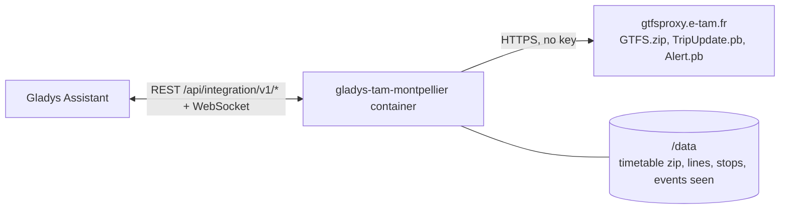
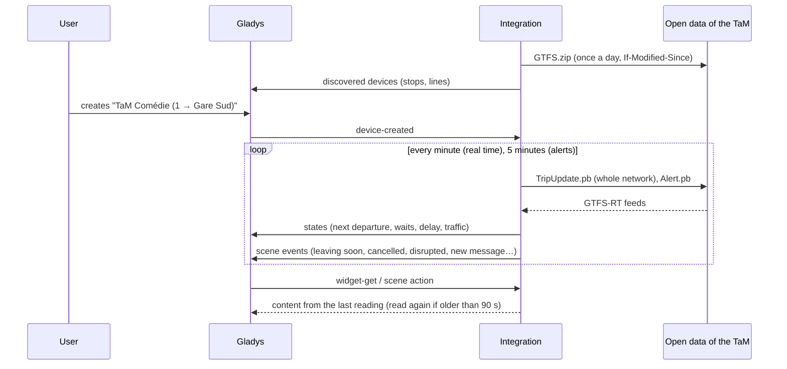
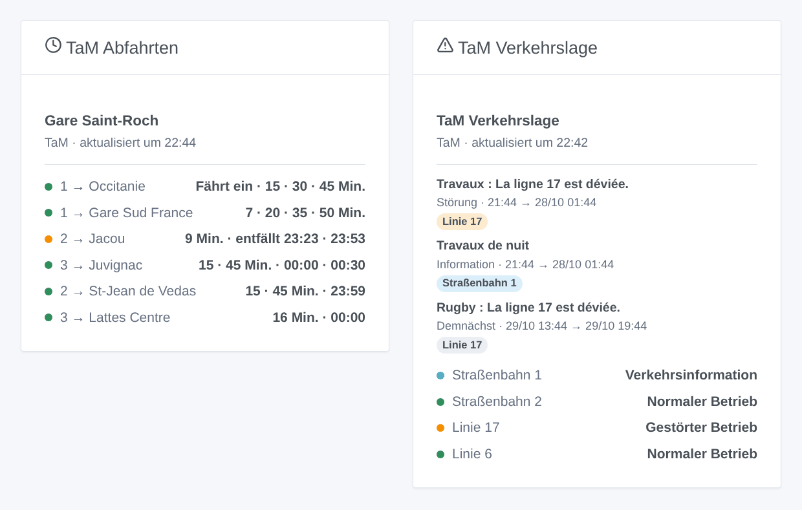

# Gladys TaM Montpellier

[English](README.md) · [Français](README.fr.md) · **Deutsch** · [Español](README.es.md)

[](LICENSE)
[](https://github.com/William-De71/gladys-tam-montpellier/releases)
[](https://github.com/William-De71/gladys-tam-montpellier/actions/workflows/release.yml)
[](https://gladysassistant.com)


Externe Integration für [Gladys Assistant](https://gladysassistant.com) für die **TaM**, die Trams und Busse von Montpellier: die nächsten Abfahrten an deinen Haltestellen, in Echtzeit korrigiert, mit ihrer Verspätung und den ausgefallenen Fahrten, und die Verkehrslage deiner Linien, mit Szenen und Dashboard-Widgets. Sie liest die offiziellen Open Data der TaM (GTFS und GTFS-RT), ohne Konto und ohne Schlüssel.

Benutzerdokumentation: [English](docs/en.md) · [Français](docs/fr.md) · [Deutsch](docs/de.md) · [Español](docs/es.md).

> Community-Integration, weder mit der TaM noch mit Montpellier Méditerranée Métropole verbunden oder von ihnen unterstützt.

## Funktionen

- **Ein Gerät pro verfolgter Haltestelle** (drei im Formular, bis zu 10 weitere mit der Schaltfläche **Haltestelle hinzufügen**), per Name oder Bahnsteigcode eingegeben und nach **Linie** und **Richtung** gefiltert: nächste Abfahrt, Wartezeit der nächsten zwei Abfahrten, Verspätung der nächsten.
- **Ein Gerät pro verfolgter Linie** (bis zu sechs), Trams und Busse, städtisch und vorstädtisch: ihr Verkehrszustand (normal, Verkehrsinformation, gestört, stark gestört) nach den Meldungen der TaM und die laufenden Meldungen.
- **Echtzeit**: geschätzte Zeit und Verspätung, sobald das Fahrzeug seine Endhaltestelle verlassen hat, sonst der Fahrplan (als solcher gekennzeichnet), ausgefallene Fahrten und nicht bediente Haltestellen.
- **5 Szenen-Auslöser**, **2 Szenen-Aktionen** und **2 Dashboard-Widgets** (unten).
- **Eine einzige Anfrage für alle verfolgten Haltestellen**: die Echtzeit des ganzen Netzes standardmäßig jede Minute (30 s bis 5 min, nachts alle 10 min, wenn nichts angekündigt ist), die Meldungen alle 5 Minuten, der Fahrplan einmal am Tag und nur, wenn er sich geändert hat (in `/data` gespeichert).
- Konfigurationsschaltflächen: Verbindung testen, Haltestelle suchen (Bahnsteigcodes, Linien), Haltestellen hinzufügen / entfernen / auflisten, Diagnose.
- Vier Sprachen überall: Englisch, Französisch, Deutsch, Spanisch.

## Funktionsweise




Beim Start lädt die Integration den Fahrplan (`GTFS.zip`, 4 MB) herunter und speichert ihn in `/data`; an den folgenden Tagen fragt sie ihn mit `If-Modified-Since` erneut ab und lädt nur eine neue Version herunter. Sie liest die Linien (`routes.txt`) und fasst die Bahnsteige eines Namens zu einer Haltestelle zusammen (`stops.txt`: „Comédie“ vereint die Bahnsteige aller Trams und Busse). Dann löst sie deine Eingaben auf: „tram 1“ ist die Linie `1`, „comedie“ die Haltestelle Comédie, „41115“ die Haltestelle dieses Bahnsteigs. Aus dem Zip zieht sie die Abfahrten der verfolgten Haltestellen über acht Tage (`stop_times.txt` wird Zeile für Zeile gelesen, ohne seine 25 MB je im Speicher zu halten). Mit ihrem eigenen Timer liest sie die Fahrtaktualisierungen des ganzen Netzes (`TripUpdate.pb`, eine Anfrage, egal wie viele Haltestellen) und korrigiert jede Abfahrt ihrer Fahrt mit der Schätzung des Bahnsteigs; alle 5 Minuten liest sie die Meldungen (`Alert.pb`). Jede Lesung wird mit der vorherigen verglichen, um die Szenen-Auslöser zu feuern.



### Transport

Nur Cloud (`"transports": ["cloud"]`): Der Katalog zeigt das Cloud-Abzeichen. Die Integration kontaktiert `gtfsproxy.e-tam.fr`. Es gibt keinen lokalen Zugang, daher keine Schaltfläche „Lokale Verbindung bevorzugen“.

## Geräte und Funktionen

| Gerät               | Funktion                           | Kategorie / Typ              | Werte                                               |
| ------------------- | ---------------------------------- | ---------------------------- | --------------------------------------------------- |
| TaM \<Haltestelle\> | Nächste Abfahrt                    | `text` / `text`              | „1 → Gare Sud France · 3 Min. (+2 Min. Verspätung)“ |
| TaM \<Haltestelle\> | Wartezeit, Wartezeit der folgenden | `duration` / `integer`       | 0 … 180 Min.                                        |
| TaM \<Haltestelle\> | Verspätung der nächsten Abfahrt    | `duration` / `integer`       | 0 … 120 Min.                                        |
| TaM Tram / Linie    | Verkehrslage                       | `text` / `text`              | „Gestörter Betrieb: La ligne 17 est déviée.“        |
| TaM Tram / Linie    | Aktuelle Verkehrsmeldungen         | `counter-sensor` / `integer` | 0 … 20                                              |

Ohne Abfahrt in den nächsten drei Stunden zeigt die Haltestelle die erste Abfahrt am Morgen; die Verspätung wird nur für eine in Echtzeit verfolgte Abfahrt veröffentlicht.

## Szenen-Auslöser, Aktionen und Widgets



**Szenen-Auslöser** (einmal pro Übergang; die erste Lesung ist eine Referenz und löst nichts aus):

- **Abfahrt bald**: Eine Abfahrt an einer verfolgten Haltestelle fährt in 2, 3, 5, 10, 15 oder 20 Minuten ab, nach ihrer Echtzeitschätzung. Filter: Haltestelle, Minuten.
- **Abfahrt entfällt**: Eine Fahrt der nächsten Stunde an einer verfolgten Haltestelle fällt aus oder bedient sie nicht. Filter: Haltestelle.
- **Linie gestört**: Eine verfolgte Linie wird gestört oder stark gestört. Filter: Linie.
- **Wieder normal**: Auf der Linie gibt es keine laufende Störung mehr. Filter: Linie.
- **Neue Verkehrsmeldung**: Die TaM veröffentlicht eine Meldung zu einer verfolgten Linie, aktuell oder demnächst. Filter: Linie, Art (Information, Störung, starke Störung).

**Szenen-Aktionen**: **nächste Abfahrten** einer Haltestelle (Linie, Ziel, Wartezeit, Uhrzeit, Echtzeit oder nicht, Verspätung, die folgende, ein Satz) und **Verkehrslage einer Linie** (Zustand, Meldungen, letzte Meldung, ein Satz).

**Widgets**: **TaM Abfahrten** (eine verfolgte Haltestelle, mehrere in einer Liste oder eine beliebige, in den Einstellungen eingegebene Haltestelle) und **TaM Verkehrslage** (die verfolgten Linien, die eingegebenen oder standardmäßig die fünf Tramlinien).

Beispiele:

- Wenn **die Tram 1 Richtung Gare Sud France in 5 Minuten an Comédie abfährt** → die Lampe im Flur grün schalten.
- Wenn **eine Abfahrt deiner Haltestelle entfällt** oder **die Linie 17 umgeleitet wird** → `{{triggerEvent.data.summary}}` aufs Handy schicken.
- Jeden Werktag um 7:30 → **die nächsten Abfahrten lesen** und die `summary` vom Küchenlautsprecher sprechen lassen.

## Voraussetzungen

- Gladys Assistant **5.3.0** oder neuer (Widgets und Szenen-Auslöser externer Integrationen, Katalog-Schlüsselwörter und Länder von Gladys 5.3). Ältere Instanzen können die Integration nicht installieren.
- Sonst nichts: Die Open Data der TaM brauchen weder Konto noch Schlüssel.

## Installation

- **Aus dem Store** von Gladys (Integrationen → Externe Integrationen), mit einem Klick, sobald indexiert.
- **Über die URL des Repositorys**: `https://github.com/William-De71/gladys-tam-montpellier`.
- **Entwicklermodus**: Baue das Image lokal (`docker build -t gladys-tam-montpellier .`) und installiere es aus Gladys.

## Konfiguration

| Feld                  | Beschreibung                                                                                                |
| --------------------- | ----------------------------------------------------------------------------------------------------------- |
| Haltestelle (1 bis 3) | Ein Name, wie er an der Haltestelle steht („Comédie“, „Gare Saint-Roch“), oder ein Bahnsteigcode („41115“). |
| Linie                 | „1“, „6“, „Amigo“. Leer: alle Linien der Haltestelle.                                                       |
| Richtung              | Wörter des Ziels: „Gare Sud“, „Jacou \| Sabines“. Leer: beide.                                              |
| Verfolgte Linien      | Bis zu sechs, durch Kommas getrennt: „1, 2, 6, 17“.                                                         |
| Lesen der Echtzeit    | 30 s, 1 min (Standard), 2 min oder 5 min.                                                                   |
| Sprache der Texte     | Gerätenamen, Zusammenfassungen und Ausgaben der Szenen.                                                     |

Schaltflächen: **Verbindung testen**, **Haltestelle suchen** (Bahnsteigcodes und Linien jeder gefundenen Haltestelle), **Haltestelle hinzufügen**, **Haltestelle entfernen**, **Haltestellen auflisten** (die Haltestellen über die drei des Formulars hinaus, in der Gladys-Konfiguration gespeichert) und **Diagnose** (schreibt Haltestellen, Linien, gespeicherten Fahrplan, letzte Abfahrten, Fehler und Anfragen in den Tab Protokolle).

## Verwendung

1. Gib eine bis drei Haltestellen ein — mehr mit **Haltestelle hinzufügen** — (auf Wunsch mit Linie und Richtung) sowie die zu verfolgenden Linien und speichere.
2. Erstelle im Tab **Entdecken** die Geräte „TaM …“.
3. Füge die Widgets **TaM Abfahrten** und **TaM Verkehrslage** einem Dashboard hinzu und baue Szenen mit den Auslösern oben.

## Entwicklung

```bash
npm install
npm test                       # node --test, nie mit dem Netz
npm run lint && npm run format:check
npx github:GladysAssistant/integration-store . --skip-image-check
scripts/build-cover.sh         # cover.jpg aus docs/assets/cover.svg
docs/illustrations/render.sh   # docs/assets/widgets.<lang>.png
node .github/scripts/release.mjs next
```

Lokal liest das SDK `GLADYS_HOST_API_URL`, `GLADYS_INTEGRATION_TOKEN` und `GLADYS_INTEGRATION_SELECTOR`; `TAM_API_URL` leitet die Integration auf eine andere Feed-Wurzel um (eine Attrappe); `DEBUG=gladys-integration-sdk` zeigt die SDK-Protokolle und prüft jeden Widget-Inhalt. Die Tests nutzen echte, reduzierte Open Data der TaM (`test/fixtures/`, ODbL): Das Zip wird von `test/helpers/fixtures.js` gebaut und die Feeds kodiert. Die Regeln des Projekts stehen in [CLAUDE.md](CLAUDE.md).

## Release-Prozess


Jeder Merge auf `main` startet die CI und berechnet dann die Version aus den [Conventional Commits](https://www.conventionalcommits.org/) seit dem letzten Tag: `feat` → Minor, `fix` / `perf` → Patch, `!` oder `BREAKING CHANGE` → Major (vor 1.0.0 ein Minor); `docs`, `chore`, `ci`, `test`, `style`, `refactor`, `build` allein veröffentlichen nichts. Der Changelog-Abschnitt wird erzeugt, der Tag gepusht, das Multi-Architektur-Image gebaut, dann erhält `main` den Release-Commit, das GitHub Release wird erstellt, und ein letzter Job prüft das öffentliche Image, den Store-Validator und das Topic.

- Der Titel des Pull Requests wird zum Squash-Commit und dann zur Changelog-Zeile: Schreibe ihn auf Englisch, für die Nutzer (`pr-title.yml` prüft ihn). Bearbeite `CHANGELOG.md` nie von Hand.
- 1.0.0 ist eine Entscheidung: Actions → Release → Run workflow mit `release-as: 1.0.0`. `dry-run` zeigt Version und Notizen, ohne etwas zu veröffentlichen.
- **Geschützter Branch**: Das Release pusht seinen Commit mit `GITHUB_TOKEN` auf `main`. Mit einem Ruleset auf `main`, das strenger ist als „kein Löschen, kein Force-Push“, füge GitHub Actions zu seiner Bypass-Liste hinzu (oder pushe über eine GitHub App), sonst schlägt der Veröffentlichungsjob mit Anweisungen fehl.
- Mache nach dem ersten Release das Paket `ghcr.io` öffentlich (Package settings → Change visibility), sonst kann Gladys es nicht herunterladen.

## Fehlerbehebung

Siehe [docs/de.md](docs/de.md#fehlerbehebung). Melde Probleme mit den Versionen von Gladys und der Integration, der betroffenen Haltestelle oder Linie und den Zeilen der Schaltfläche **Diagnose**.

## Mitwirken

Issues und Pull Requests sind willkommen. Führe vor einem Pull Request `npm run format:check && npm run lint && npm test` aus und lass alle externen IDs und gespeicherten Schlüssel unverändert (siehe [CLAUDE.md](CLAUDE.md)).

## Sicherheit

Siehe [SECURITY.md](SECURITY.md): Melde Schwachstellen vertraulich. Die Integration braucht kein Geheimnis: Sie liest nur öffentliche Open Data und läuft schreibgeschützt, als Benutzer ohne Root-Rechte, in ihrem Container.

## Kommende Screenshots

Die Bilder oben sind Illustrationen, keine Screenshots. Echte Screenshots kommen nach `docs/assets/screenshots/` (PNG, 1280 × 800): `configuration.png`, `discovery.png`, `device.png`, `scene.png`.

## Lizenz

[Apache License 2.0](LICENSE) — siehe auch [NOTICE](NOTICE). Fahrplan, Echtzeit und Meldungen sind Open Data der TaM (Montpellier Méditerranée Métropole) unter der [Open Database License (ODbL)](https://opendatacommons.org/licenses/odbl/1-0/): Die Widgets zeigen die Quelle und die Uhrzeit jeder Lesung. Danke an die Dokumentation und das SDK von Gladys und an Montpellier Méditerranée Métropole für die Veröffentlichung dieser Daten in Echtzeit.
