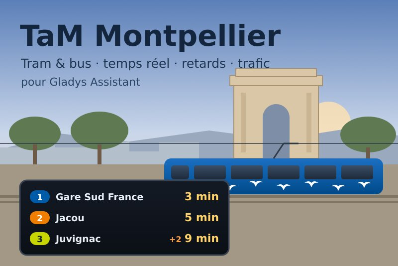
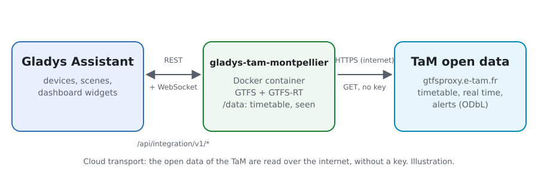
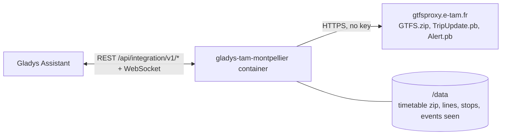
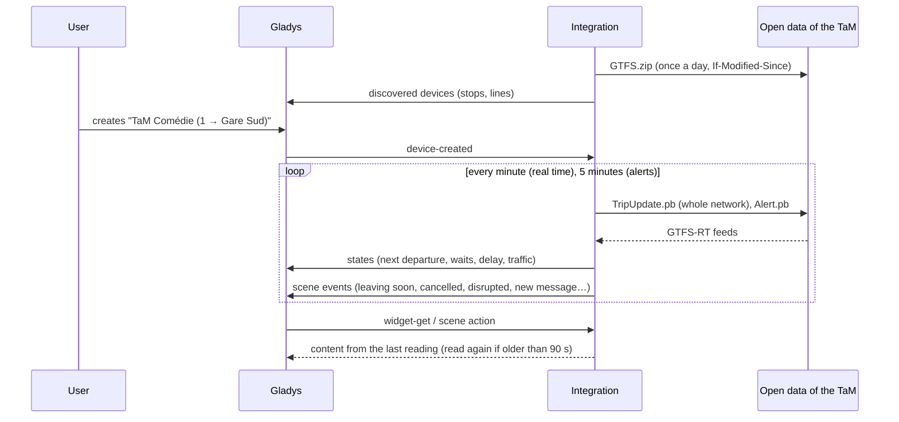
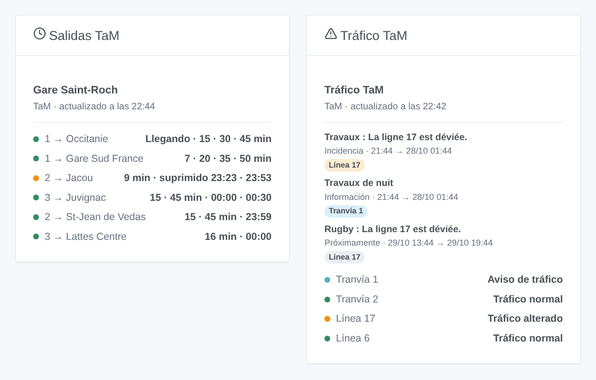

# Gladys TaM Montpellier

[English](README.md) · [Français](README.fr.md) · [Deutsch](README.de.md) · **Español**

[](LICENSE)
[](https://github.com/William-De71/gladys-tam-montpellier/releases)
[](https://github.com/William-De71/gladys-tam-montpellier/actions/workflows/release.yml)
[](https://gladysassistant.com)



Integración externa de [Gladys Assistant](https://gladysassistant.com) para **TaM**, los tranvías y autobuses de Montpellier: las próximas salidas en tus paradas, corregidas en tiempo real, con su retraso y los viajes suprimidos, y el tráfico de tus líneas, con escenas y widgets de panel. Lee los datos abiertos oficiales de TaM (GTFS y GTFS-RT), sin cuenta ni clave.

Documentación de usuario: [English](docs/en.md) · [Français](docs/fr.md) · [Deutsch](docs/de.md) · [Español](docs/es.md).

> Integración comunitaria, sin afiliación ni respaldo de TaM ni de Montpellier Méditerranée Métropole.

## Funciones

- **Un dispositivo por parada seguida** (tres en el formulario, hasta 10 más con el botón **Añadir una parada**), escrita por nombre o código de andén, y filtrada por **línea** y **dirección**: próxima salida, espera de las dos próximas salidas, retraso de la próxima.
- **Un dispositivo por línea seguida** (hasta seis), tranvías y autobuses, urbanos y suburbanos: su estado de tráfico (normal, aviso de tráfico, alterado, muy alterado) según las alertas de TaM, y los avisos en curso.
- **Tiempo real**: hora estimada y retraso en cuanto el vehículo sale de su cabecera, el horario teórico si no (indicado como tal), los viajes suprimidos y las paradas sin servicio.
- **5 desencadenantes de escena**, **2 acciones de escena** y **2 widgets de panel** (abajo).
- **Una sola petición para todas las paradas seguidas**: el tiempo real de toda la red cada minuto por defecto (30 s a 5 min, cada 10 min de noche cuando no se anuncia nada), las alertas cada 5 minutos, el horario una vez al día y solo si cambió (guardado en `/data`).
- Botones de configuración: probar la conexión, buscar una parada (códigos de andén, líneas), añadir / quitar / listar paradas, diagnóstico.
- Cuatro idiomas en todas partes: inglés, francés, alemán, español.

## Funcionamiento





Al arrancar, la integración descarga el horario (`GTFS.zip`, 4 MB) y lo guarda en `/data`; los días siguientes lo vuelve a pedir con `If-Modified-Since` y solo descarga una versión nueva. Lee las líneas (`routes.txt`) y reúne los andenes de un mismo nombre en una parada (`stops.txt`: «Comédie» reúne los andenes de todos los tranvías y autobuses). Luego resuelve lo que escribiste: «tram 1» es la línea `1`, «comedie» la parada Comédie, «41115» la parada de ese andén. Del zip extrae las salidas de las paradas seguidas durante ocho días (`stop_times.txt` se lee línea a línea, sin guardar nunca sus 25 MB en memoria). Con su propio temporizador lee las actualizaciones de viajes de toda la red (`TripUpdate.pb`, una petición sea cual sea el número de paradas) y corrige cada salida de su viaje con la estimación del andén; cada 5 minutos lee las alertas (`Alert.pb`). Cada lectura se compara con la anterior para lanzar los desencadenantes de escena.



### Transporte

Solo cloud (`"transports": ["cloud"]`): el catálogo muestra la insignia cloud. La integración contacta con `gtfsproxy.e-tam.fr`. No hay acceso local, así que no hay botón «Preferir la conexión local».

## Dispositivos y funciones

| Dispositivo         | Función                      | Categoría / tipo             | Valores                                           |
| ------------------- | ---------------------------- | ---------------------------- | ------------------------------------------------- |
| TaM \<parada\>      | Próximo paso                 | `text` / `text`              | «1 → Gare Sud France · 3 min (+2 min de retraso)» |
| TaM \<parada\>      | Espera, espera del siguiente | `duration` / `integer`       | 0 … 180 min                                       |
| TaM \<parada\>      | Retraso del próximo paso     | `duration` / `integer`       | 0 … 120 min                                       |
| TaM tranvía / línea | Tráfico                      | `text` / `text`              | «Tráfico alterado: La ligne 17 est déviée.»       |
| TaM tranvía / línea | Avisos de tráfico en curso   | `counter-sensor` / `integer` | 0 … 20                                            |

Sin salidas en las próximas tres horas, la parada muestra la primera salida de la mañana; el retraso solo se publica para una salida seguida en tiempo real.

## Disparadores, acciones y widgets



**Desencadenantes de escena** (una vez por transición; la primera lectura es una referencia y no lanza nada):

- **Salida en breve**: una salida de una parada seguida sale dentro de 2, 3, 5, 10, 15 o 20 minutos, según su estimación en tiempo real. Filtros: parada, minutos.
- **Salida suprimida**: un viaje de la próxima hora en una parada seguida se suprime o no para en ella. Filtro: parada.
- **Línea alterada**: una línea seguida pasa a alterada o muy alterada. Filtro: línea.
- **Fin de la incidencia**: ya no hay incidencias en curso en la línea. Filtro: línea.
- **Nuevo aviso de tráfico**: TaM publica una alerta sobre una línea seguida, en curso o próxima. Filtros: línea, tipo (información, incidencia, incidencia grave).

**Acciones de escena**: **próximas salidas** de una parada (línea, destino, espera, hora, tiempo real o no, retraso, la siguiente, una frase) y **tráfico de una línea** (estado, avisos, último aviso, una frase).

**Widgets**: **Salidas TaM** (una parada seguida, varias en una lista, o cualquier parada escrita en los ajustes) y **Tráfico TaM** (las líneas seguidas, las escritas, o las cinco líneas de tranvía por defecto).

Ejemplos:

- Cuando **el tranvía 1 hacia Gare Sud France sale de Comédie dentro de 5 minutos** → encender en verde la lámpara de la entrada.
- Cuando **se suprime una salida de tu parada** o **la línea 17 se desvía** → enviar `{{triggerEvent.data.summary}}` a tu móvil.
- Cada día laborable a las 7:30 → **leer las próximas salidas** de tu parada y que el altavoz de la cocina diga el `summary`.

## Requisitos

- Gladys Assistant **5.3.0** o posterior (widgets y desencadenantes de escena de las integraciones externas, palabras clave y países del catálogo de Gladys 5.3). Las instancias más antiguas no pueden instalar la integración.
- Nada más: los datos abiertos de TaM no piden ni cuenta ni clave.

## Instalación

- **Desde la tienda** de Gladys (Integraciones → Integraciones externas), con un clic, una vez indexada.
- **Desde la URL del repositorio**: `https://github.com/William-De71/gladys-tam-montpellier`.
- **Modo desarrollador**: construye la imagen en local (`docker build -t gladys-tam-montpellier .`) e instálala desde Gladys.

## Configuración

| Campo                   | Descripción                                                                                            |
| ----------------------- | ------------------------------------------------------------------------------------------------------ |
| Parada (1 a 3)          | Un nombre tal como aparece en la parada («Comédie», «Gare Saint-Roch») o un código de andén («41115»). |
| Línea                   | «1», «6», «Amigo». Vacío: todas las líneas de la parada.                                               |
| Dirección               | Palabras del destino: «Gare Sud», «Jacou \| Sabines». Vacío: ambos.                                    |
| Líneas seguidas         | Hasta seis, separadas por comas: «1, 2, 6, 17».                                                        |
| Lectura del tiempo real | 30 s, 1 min (por defecto), 2 min o 5 min.                                                              |
| Idioma de los textos    | Nombres de los dispositivos, resúmenes y salidas de las escenas.                                       |

Botones: **Probar la conexión**, **Buscar una parada** (códigos de andén y líneas de cada parada encontrada), **Añadir una parada**, **Quitar una parada**, **Listar las paradas** (las paradas más allá de las tres del formulario, guardadas en la configuración de Gladys) y **Diagnóstico** (escribe las paradas, líneas, horario guardado, últimas salidas, errores y peticiones en la pestaña Registros).

## Uso

1. Escribe de una a tres paradas — más con **Añadir una parada** — (con su línea y dirección si quieres) y las líneas a seguir, y guarda.
2. En la pestaña **Descubrir**, crea los dispositivos «TaM …».
3. Añade los widgets **Salidas TaM** y **Tráfico TaM** a un panel, y crea escenas con los desencadenantes de arriba.

## Desarrollo

```bash
npm install
npm test                       # node --test, nunca toca la red
npm run lint && npm run format:check
npx github:GladysAssistant/integration-store . --skip-image-check
scripts/build-cover.sh         # cover.jpg desde docs/assets/cover.svg
docs/illustrations/render.sh   # docs/assets/widgets.<lang>.png
node .github/scripts/release.mjs next
```

En local, el SDK lee `GLADYS_HOST_API_URL`, `GLADYS_INTEGRATION_TOKEN` y `GLADYS_INTEGRATION_SELECTOR`; `TAM_API_URL` dirige la integración a otra raíz de flujos (un simulador); `DEBUG=gladys-integration-sdk` muestra los registros del SDK y comprueba cada contenido de widget. Las pruebas usan datos abiertos reales de TaM, reducidos (`test/fixtures/`, ODbL): `test/helpers/fixtures.js` construye el zip y codifica los flujos. Las reglas del proyecto están en [CLAUDE.md](CLAUDE.md).

## Proceso de release


Cada fusión en `main` lanza la CI y luego calcula la versión según los [Conventional Commits](https://www.conventionalcommits.org/) desde la última etiqueta: `feat` → menor, `fix` / `perf` → parche, `!` o `BREAKING CHANGE` → mayor (una menor antes de 1.0.0); `docs`, `chore`, `ci`, `test`, `style`, `refactor`, `build` solos no publican nada. Se genera la sección del changelog, se sube la etiqueta, se construye la imagen multiarquitectura, luego `main` recibe el commit de release, se crea la GitHub Release y un último job comprueba la imagen pública, el validador de la tienda y el topic.

- El título del pull request se convierte en el commit squash y luego en la línea del changelog: escríbelo en inglés, para el usuario (`pr-title.yml` lo comprueba). No edites nunca `CHANGELOG.md` a mano.
- La 1.0.0 es una decisión: Actions → Release → Run workflow con `release-as: 1.0.0`. `dry-run` muestra la versión y las notas sin publicar nada.
- **Rama protegida**: la release sube su commit a `main` con `GITHUB_TOKEN`. Con un ruleset en `main` más estricto que «sin borrado, sin force-push», añade GitHub Actions a su lista de exclusión (o sube mediante una GitHub App); si no, el job de publicación falla con instrucciones.
- Tras la primera release, haz público el paquete `ghcr.io` (Package settings → Change visibility); si no, Gladys no puede descargarlo.

## Solución de problemas

Consulta [docs/es.md](docs/es.md#solución-de-problemas). Informa de los problemas con las versiones de Gladys y de la integración, la parada o línea afectada y las líneas del botón **Diagnóstico**.

## Contribuir

Issues y pull requests bienvenidos. Ejecuta `npm run format:check && npm run lint && npm test` antes de abrir un pull request, y mantén sin cambios todos los identificadores externos y claves guardadas (ver [CLAUDE.md](CLAUDE.md)).

## Seguridad

Consulta [SECURITY.md](SECURITY.md): informa de las vulnerabilidades en privado. La integración no necesita ningún secreto: solo lee datos abiertos públicos, y se ejecuta en solo lectura, con un usuario sin privilegios de root, en su contenedor.

## Capturas por venir

Las imágenes de arriba son ilustraciones, no capturas de pantalla. Las capturas reales irán en `docs/assets/screenshots/` (PNG, 1280 × 800): `configuration.png`, `discovery.png`, `device.png`, `scene.png`.

## Licencia

[Licencia Apache 2.0](LICENSE) — ver también [NOTICE](NOTICE). El horario, el tiempo real y las alertas son datos abiertos de TaM (Montpellier Méditerranée Métropole) bajo la [Open Database License (ODbL)](https://opendatacommons.org/licenses/odbl/1-0/): los widgets muestran la fuente y la hora de cada lectura. Gracias a la documentación y al SDK de Gladys, y a Montpellier Méditerranée Métropole por publicar estos datos en tiempo real.
