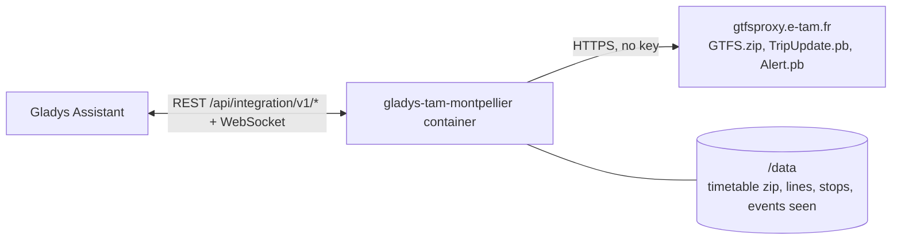
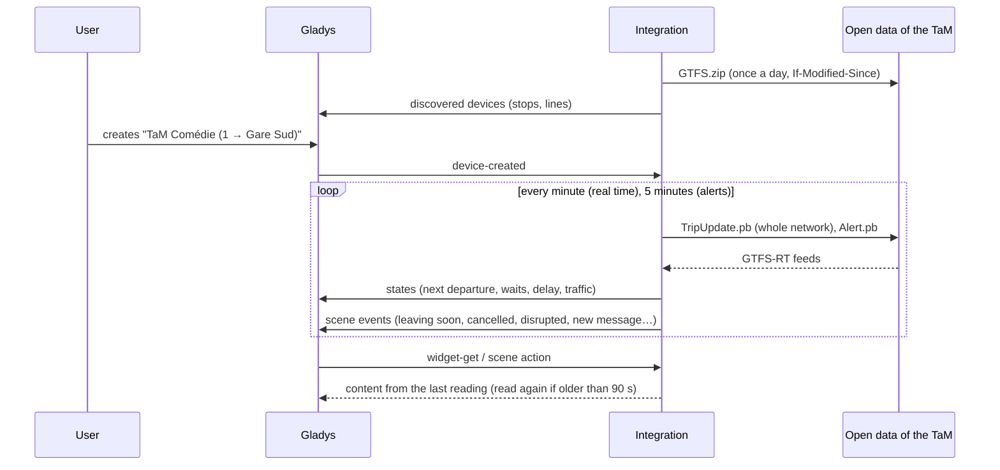
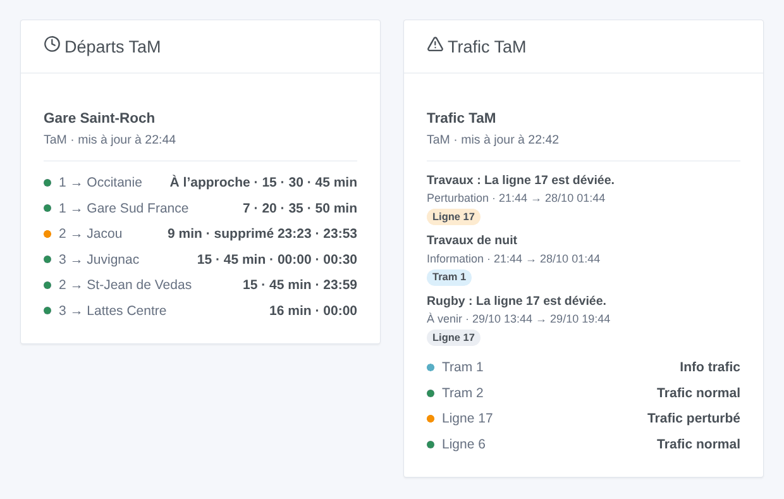

# Gladys TaM Montpellier

[English](README.md) · **Français** · [Deutsch](README.de.md) · [Español](README.es.md)

[](LICENSE)
[](https://github.com/William-De71/gladys-tam-montpellier/releases)
[](https://github.com/William-De71/gladys-tam-montpellier/actions/workflows/release.yml)
[](https://gladysassistant.com)


Intégration externe [Gladys Assistant](https://gladysassistant.com) pour la **TaM**, les trams et bus de Montpellier : les prochains départs à vos arrêts, corrigés en temps réel, avec leur retard et les courses supprimées, et le trafic de vos lignes, avec scènes et widgets de tableau de bord. Elle lit l’open data officiel de la TaM (GTFS et GTFS-RT), sans compte ni clé.

Documentation utilisateur : [English](docs/en.md) · [Français](docs/fr.md) · [Deutsch](docs/de.md) · [Español](docs/es.md).

> Intégration communautaire, ni affiliée ni approuvée par la TaM ou Montpellier Méditerranée Métropole.

## Fonctionnalités

- **Un appareil par arrêt suivi** (trois dans le formulaire, jusqu’à 10 de plus avec le bouton **Ajouter un arrêt**), saisi par son nom ou un code de quai, et filtré par **ligne** et **direction** : prochain départ, attente des deux prochains départs, retard du prochain.
- **Un appareil par ligne suivie** (six au plus), trams et bus, urbains et suburbains : son état de trafic (normal, info trafic, perturbé, très perturbé) d’après les alertes de la TaM, et les messages en cours.
- **Temps réel** : l’heure estimée et le retard dès que le véhicule a quitté son terminus, les horaires théoriques sinon (signalés comme tels), les courses supprimées et les arrêts non desservis.
- **5 déclencheurs de scène**, **2 actions de scène** et **2 widgets de tableau de bord** (ci-dessous).
- **Une seule requête pour tous les arrêts suivis** : le temps réel de tout le réseau chaque minute par défaut (30 s à 5 min, toutes les 10 min la nuit quand rien n’est annoncé), les alertes toutes les 5 minutes, les horaires une fois par jour seulement s’ils ont changé (gardés dans `/data`).
- Boutons de configuration : tester la connexion, chercher un arrêt (codes de quais, lignes), ajouter / retirer / lister des arrêts, diagnostic.
- Quatre langues partout : anglais, français, allemand, espagnol.

## Fonctionnement




Au démarrage, l’intégration télécharge les horaires (`GTFS.zip`, 4 Mo) et les garde dans `/data` ; les jours suivants elle les redemande avec `If-Modified-Since` et ne télécharge qu’une nouvelle version. Elle lit les lignes (`routes.txt`) et réunit les quais d’un même nom en un arrêt (`stops.txt` : « Comédie » réunit les quais de tous les trams et bus). Elle résout ensuite ce que vous avez saisi : « tram 1 » est la ligne `1`, « comedie » l’arrêt Comédie, « 41115 » l’arrêt de ce quai. Du zip, elle extrait les départs des arrêts suivis sur huit jours (`stop_times.txt` est lu ligne à ligne, sans jamais garder ses 25 Mo en mémoire). Sur sa propre minuterie, elle lit les mises à jour de courses de tout le réseau (`TripUpdate.pb`, une requête quel que soit le nombre d’arrêts) et corrige chaque départ de sa course avec l’estimation du quai ; toutes les 5 minutes, elle lit les alertes (`Alert.pb`). Chaque lecture est comparée à la précédente pour lancer les déclencheurs de scène.



### Transport

Cloud uniquement (`"transports": ["cloud"]`) : le catalogue affiche le badge cloud. L’intégration contacte `gtfsproxy.e-tam.fr`. Il n’existe pas d’accès local, donc pas de bouton « Préférer la connexion locale ».

## Appareils et fonctionnalités

| Appareil         | Fonctionnalité              | Catégorie / type             | Valeurs                                            |
| ---------------- | --------------------------- | ---------------------------- | -------------------------------------------------- |
| TaM \<arrêt\>    | Prochain passage            | `text` / `text`              | « 1 → Gare Sud France · 3 min (+2 min de retard) » |
| TaM \<arrêt\>    | Attente, attente du suivant | `duration` / `integer`       | 0 … 180 min                                        |
| TaM \<arrêt\>    | Retard du prochain passage  | `duration` / `integer`       | 0 … 120 min                                        |
| TaM tram / ligne | Trafic                      | `text` / `text`              | « Trafic perturbé : La ligne 17 est déviée. »      |
| TaM tram / ligne | Infos trafic en cours       | `counter-sensor` / `integer` | 0 … 20                                             |

Sans départ dans les trois heures, l’arrêt donne le premier départ du matin ; le retard n’est publié que pour un départ suivi en temps réel.

## Déclencheurs, actions et widgets



**Déclencheurs de scène** (une fois par transition ; la première lecture sert de référence et ne déclenche rien) :

- **Départ bientôt** : un départ d’un arrêt suivi part dans 2, 3, 5, 10, 15 ou 20 minutes, sur son estimation en temps réel. Filtres : arrêt, minutes.
- **Départ supprimé** : une course de l’heure à venir d’un arrêt suivi est supprimée ou ne le dessert pas. Filtre : arrêt.
- **Ligne perturbée** : une ligne suivie devient perturbée ou très perturbée. Filtre : ligne.
- **Fin de perturbation** : plus aucune perturbation en cours sur la ligne. Filtre : ligne.
- **Nouveau message trafic** : la TaM publie une alerte sur une ligne suivie, en cours ou à venir. Filtres : ligne, type (information, perturbation, forte perturbation).

**Actions de scène** : **prochains départs** d’un arrêt (ligne, destination, attente, heure, temps réel ou non, retard, le suivant, une phrase) et **trafic d’une ligne** (état, messages, dernier message, une phrase).

**Widgets** : **Départs TaM** (un arrêt suivi, plusieurs dans une liste, ou n’importe quel arrêt saisi dans les réglages) et **Trafic TaM** (les lignes suivies, celles saisies, ou les cinq lignes de tram par défaut).

Exemples :

- Quand **le tram 1 vers Gare Sud France part de Comédie dans 5 minutes** → allumer la lampe de l’entrée en vert.
- Quand **un départ de votre arrêt est supprimé** ou que **la ligne 17 est déviée** → envoyer `{{triggerEvent.data.summary}}` sur votre téléphone.
- Chaque jour de semaine à 7 h 30 → **lire les prochains départs** de votre arrêt et faire dire le `summary` par l’enceinte de la cuisine.

## Prérequis

- Gladys Assistant **5.3.0** ou plus récent (widgets et déclencheurs de scène des intégrations externes, mots-clés et pays du catalogue de Gladys 5.3). Les instances plus anciennes ne peuvent pas installer l’intégration.
- Rien d’autre : l’open data de la TaM ne demande ni compte ni clé.

## Installation

- **Depuis le store** de Gladys (Intégrations → Intégrations externes), en un clic, une fois indexée.
- **Depuis l’URL du dépôt** : `https://github.com/William-De71/gladys-tam-montpellier`.
- **Mode développeur** : construisez l’image en local (`docker build -t gladys-tam-montpellier .`) et installez-la depuis Gladys.

## Configuration

| Champ                 | Description                                                                                      |
| --------------------- | ------------------------------------------------------------------------------------------------ |
| Arrêt (1 à 3)         | Un nom tel qu’écrit à l’arrêt (« Comédie », « Gare Saint-Roch ») ou un code de quai (« 41115 »). |
| Ligne                 | « 1 », « 6 », « Amigo ». Vide : toutes les lignes de l’arrêt.                                    |
| Direction             | Des mots de la destination : « Gare Sud », « Jacou \| Sabines ». Vide : les deux.                |
| Lignes suivies        | Six au plus, séparées par des virgules : « 1, 2, 6, 17 ».                                        |
| Lecture du temps réel | 30 s, 1 min (par défaut), 2 min ou 5 min.                                                        |
| Langue des textes     | Noms des appareils, résumés et sorties des scènes.                                               |

Boutons : **Tester la connexion**, **Chercher un arrêt** (codes de quais et lignes de chaque arrêt trouvé), **Ajouter un arrêt**, **Retirer un arrêt**, **Lister les arrêts** (les arrêts au-delà des trois du formulaire, gardés dans la configuration de Gladys) et **Diagnostic** (écrit les arrêts, lignes, horaires gardés, derniers départs, erreurs et requêtes dans l’onglet Journaux).

## Utilisation

1. Saisissez un à trois arrêts — davantage avec **Ajouter un arrêt** — (avec leur ligne et leur direction si vous le souhaitez) et les lignes à suivre, puis enregistrez.
2. Dans l’onglet **Découvrir**, créez les appareils « TaM … ».
3. Ajoutez les widgets **Départs TaM** et **Trafic TaM** à un tableau de bord, et construisez des scènes avec les déclencheurs ci-dessus.

## Développement

```bash
npm install
npm test                       # node --test, ne touche jamais le réseau
npm run lint && npm run format:check
npx github:GladysAssistant/integration-store . --skip-image-check
scripts/build-cover.sh         # cover.jpg depuis docs/assets/cover.svg
docs/illustrations/render.sh   # docs/assets/widgets.<lang>.png
node .github/scripts/release.mjs next
```

En local, le SDK lit `GLADYS_HOST_API_URL`, `GLADYS_INTEGRATION_TOKEN` et `GLADYS_INTEGRATION_SELECTOR` ; `TAM_API_URL` dirige l’intégration vers une autre racine de flux (un simulateur) ; `DEBUG=gladys-integration-sdk` affiche les journaux du SDK et vérifie chaque contenu de widget. Les tests utilisent de vraies données ouvertes de la TaM, réduites (`test/fixtures/`, ODbL) : le zip est construit et les flux encodés par `test/helpers/fixtures.js`. Les règles du projet sont dans [CLAUDE.md](CLAUDE.md).

## Processus de release


Chaque fusion sur `main` lance la CI, puis calcule la version d’après les [Conventional Commits](https://www.conventionalcommits.org/) depuis le dernier tag : `feat` → mineure, `fix` / `perf` → correctif, `!` ou `BREAKING CHANGE` → majeure (une mineure avant 1.0.0) ; `docs`, `chore`, `ci`, `test`, `style`, `refactor`, `build` seuls ne publient rien. La section du changelog est générée, le tag poussé, l’image multi-architecture construite, puis `main` reçoit le commit de release, la GitHub Release est créée et un dernier job vérifie l’image publique, le validateur du store et le topic.

- Le titre de la pull request devient le commit squash, puis la ligne du changelog : écrivez-le en anglais, pour l’utilisateur (`pr-title.yml` le vérifie). N’éditez jamais `CHANGELOG.md` à la main.
- La 1.0.0 est une décision : Actions → Release → Run workflow avec `release-as: 1.0.0`. `dry-run` montre la version et les notes sans rien publier.
- **Branche protégée** : la release pousse son commit sur `main` avec `GITHUB_TOKEN`. Avec un ruleset sur `main` plus strict que « pas de suppression, pas de force-push », ajoutez GitHub Actions à sa liste de contournement (ou poussez via une GitHub App), sinon le job de publication échoue avec des instructions.
- Après la première release, rendez public le paquet `ghcr.io` (Package settings → Change visibility), sinon Gladys ne peut pas le télécharger.

## Dépannage

Voir [docs/fr.md](docs/fr.md#dépannage). Signalez les problèmes avec les versions de Gladys et de l’intégration, l’arrêt ou la ligne concernés, et les lignes du bouton **Diagnostic**.

## Contribuer

Issues et pull requests bienvenues. Lancez `npm run format:check && npm run lint && npm test` avant d’ouvrir une pull request, et gardez inchangés tous les identifiants externes et clés stockées (voir [CLAUDE.md](CLAUDE.md)).

## Sécurité

Voir [SECURITY.md](SECURITY.md) : signalez les vulnérabilités en privé. L’intégration n’a besoin d’aucun secret : elle ne lit que des données ouvertes publiques, et tourne en lecture seule, sous un utilisateur non root, dans son conteneur.

## Captures à venir

Les images ci-dessus sont des illustrations, pas des captures d’écran. Les vraies captures iront dans `docs/assets/screenshots/` (PNG, 1280 × 800) : `configuration.png`, `discovery.png`, `device.png`, `scene.png`.

## Licence

[Licence Apache 2.0](LICENSE) — voir aussi [NOTICE](NOTICE). Les horaires, le temps réel et les alertes sont des données ouvertes de la TaM (Montpellier Méditerranée Métropole) sous [Open Database License (ODbL)](https://opendatacommons.org/licenses/odbl/1-0/) : les widgets affichent la source et l’heure de chaque lecture. Merci à la documentation et au SDK de Gladys, et à Montpellier Méditerranée Métropole de publier ces données en temps réel.
